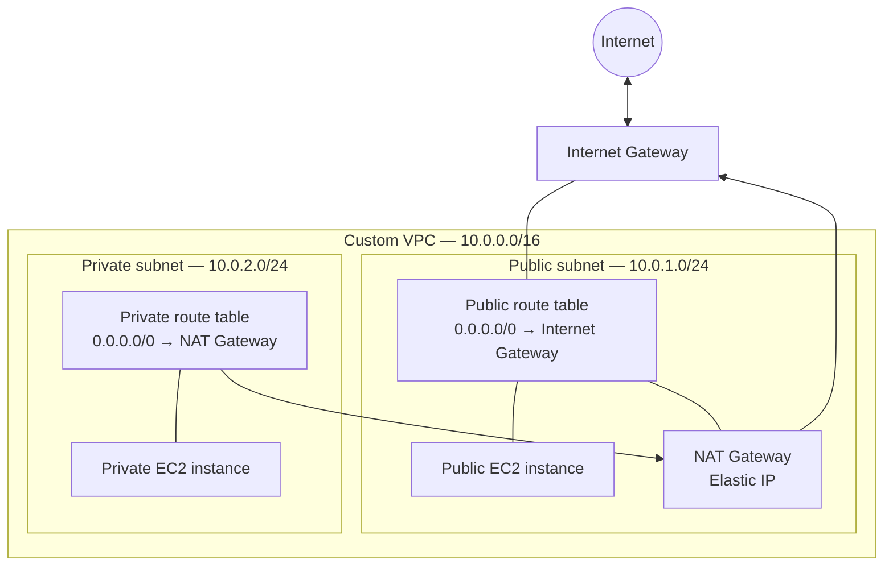

# AWS VPC & Networking Project

## Project Overview

A hands-on AWS networking project that builds a custom VPC with public and private workloads, controlled internet access, and separate routing for each subnet.

## AWS Architecture

The diagram uses the CIDR ranges from the design discussed for this project. Confirm them against the deployed AWS configuration before publishing if the actual ranges differ.

## Infrastructure Built

- Custom VPC with public and private subnets.
- Internet Gateway and NAT Gateway with an Elastic IP.
- Separate public and private route tables.
- Public and private EC2 instances.
- Security Groups for instance traffic control.

## Technical Skills Demonstrated

- AWS VPC, subnet, and EC2 configuration.
- IPv4 addressing and CIDR notation.
- Public and private network design.
- Internet and NAT Gateway routing.
- Route table and Security Group configuration.

## Technologies Used

Amazon VPC, EC2, Internet Gateway, NAT Gateway, Elastic IP, route tables, and Security Groups. Infrastructure was configured through the AWS Management Console.

## Project Status

Core infrastructure and both EC2 instances have been created. Connectivity testing and validation are ongoing.
